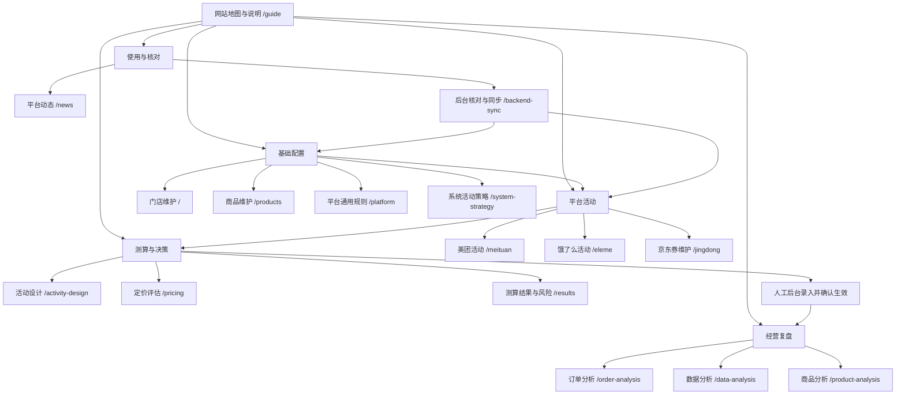

# 网站地图、平台差异与后续任务

整理日期：2026-10-12。网站入口：`/guide`，菜单「网站地图与说明」。页面可搜索功能、按分组筛选、跳转功能页、按优先级查看和导出任务。用途、输入、输出、边界与任务的维护源为 `src/data/siteGuide.ts`，页面名称与路径复用 `src/app/routes.ts`。

## 网站地图

## 当前功能与使用边界

| 页面 | 当前功能 | 边界 |
| --- | --- | --- |
| 门店维护 | 门店、起送价、距离、时段、枚举参数、费用及利润率继承 | 默认与示例值需要实际核实 |
| 商品维护 | 门店商品、成本、类别、套餐组成、三平台价格、包装费及上下架、导入和价格核对 | 平台导出不能代替成本；留意名称与编码匹配 |
| 平台通用规则 | 通用费用、利润率与基础优惠 | 不能覆盖所有合同计费结构 |
| 系统活动策略 | 活动设计与扫描使用的策略参数 | 不代表平台报名资格 |
| 美团 / 饿了么活动 | 门店满减、订单券、红包加码、商品折扣及平台费用 | 通用券录入商家承担；特殊互斥、门槛及混合分摊待核实 |
| 京东券维护 | 券门槛与分摊、满减、命中及接近触发组合 | 券分析不是平台完整结算模型 |
| 活动设计 | 建议活动、扫描、组合利润安全边界 | 改价、改费用后重新扫描；无自动发布 |
| 定价评估 | 价格和活动方案利润比较 | 不预测销量增量 |
| 测算结果 | 组合、实付、费用、利润、风险筛选及 CSV | 受枚举范围限制；不是最终账单 |
| 订单分析 | 支付价、小时、餐段、活动组合、平台与商品偏好 | 描述性归因不证明增量 |
| 数据分析 | 日报、平台汇总、漏斗、趋势、客户结构、复购、诊断与备忘 | 缺失字段不等于零，跨平台口径需核对 |
| 商品分析 | 阶段表现、价值排名、趋势与分层 | 商品匹配及成本来源需复核 |
| 平台动态 | 来源、平台主题筛选、观察建议及待核实事项 | 静态整理，非实时同步 |
| 后台核对与同步 | 文件 / 粘贴导入、差异预览、选择更新、来源、历史及撤回保护 | 不连接、不修改商家后台；未知规则会阻止同步 |
| 网站地图与说明 | 功能搜索、分类、页面跳转、差异矩阵、任务筛选与 CSV | 开发任务状态不代表已交付 |

全局支持：门店切换、本地 / 工具后台保存、工具后台登录、读取配置、JSON 导入导出。浏览器数据与服务器数据按所选模式分别保存。

## 三平台后台差异

本次复核了[美团官方费用说明](https://www.meituan.com/zh-HK/news/NN241225051008799)全文（发布于 2024-12-25）：技术服务费与履约服务费分开，履约计费与距离、金额、时段等有关，不同配送方式还会影响计费方式。该公告不证明两店当前合同费率。

淘宝闪购与京东采用项目 2026-10-10 核查记录，本次没有重新登录后台。弘金减配每单商家 3.2 元、平台 1.5 元属于既有门店活动记录，当前状态需复核；井弘不能继承该金额。详见 `docs/platform-rules-verification.md`。

共同缺口：任意合同配送阶梯及佣金基数、完整优惠分摊和互斥、真实逐单结算对账、保存后的规则到期提醒、统一导入质量报告、活动执行证据及资讯更新流程。三平台均未实现直接连接、实时库存、自动发布和自动拉取经营数据。网站已实现文件核对与本地配置同步，详见 `docs/backend-sync.md`。

## 已确定的后续任务

| 编号 | 优先级 / 状态 | 范围 | 前置条件 | 验收标准 |
| --- | --- | --- | --- | --- |
| T01 | P0 / 待采集证据 | 两店三平台真实订单结算核对 | 脱敏合同、活动规则与订单结算样本 | 逐单预计 / 实际差额和原因可查；覆盖距离、时段与券；解释平台舍入 |
| T02 | P0 / 待采集证据 | 混合券分摊、叠加互斥、门槛及起送口径 | T01 样本与规则全文 | 顾客实付和商家结算均匹配；不支持的规则明确阻止按已验证模型计算 |
| T03 | P1 / 待采集证据 | 按合同配置佣金基数及履约阶梯 | T01 确认合同结构 | 门店平台隔离、边界验证、旧配置兼容 |
| T04 | P1 / 待开发 | 来源、核实状态、有效期及测算前复核提醒 | 复用核对记录；先提醒 | 未核实 / 已核实 / 过期 / 后续变更可区分，跳转对应规则；自动停用另定规则 |
| T05 | P1 / 待开发 | 订单、日报、商品统一导入质量报告 | 脱敏导出样本与现有导入流程 | 新增 / 覆盖 / 跳过预览，缺失不填零，失败不覆盖 |
| T06 | P2 / 待开发 | 活动后台录入清单、执行状态与复盘 | T02 规则；人工平台操作 | 建议 / 待录入 / 已生效可追溯，复盘排除未生效日期 |
| T07 | P2 / 待开发 | 平台动态更新与失效管理 | 可核实公开或后台来源 | 标明资料截止、适用门店及规则影响，不把历史通知当新政策 |

先完成 T01 与 T02 的取证，再实现涉及金额的模型变更；T04、T05 可先推进。任务未指定完成日期，也不预设平台接口可用。每次新增页面同步更新功能目录，每次交付任务同步更新状态与验收证据。
